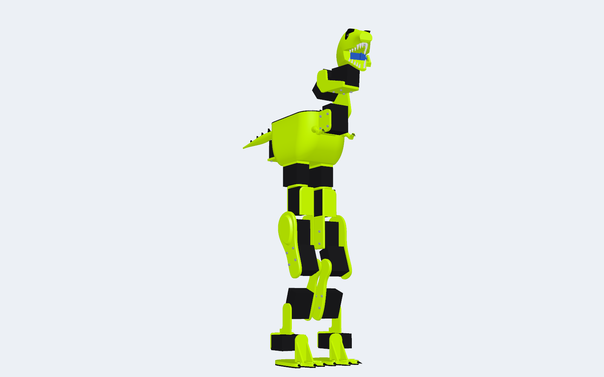
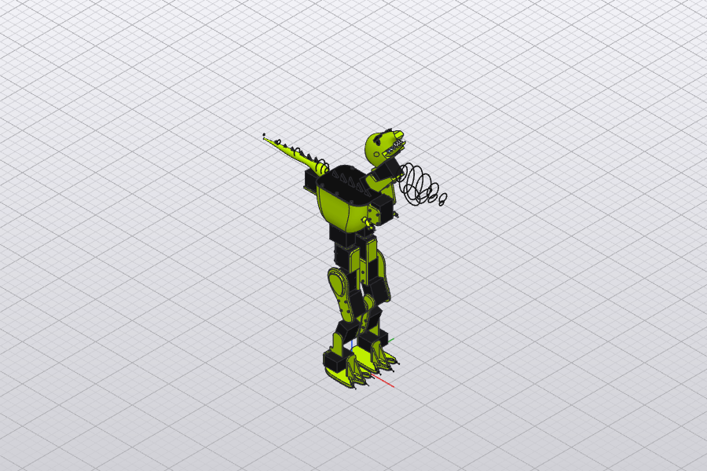

# TinyRex

A small bipedal T-rex robot, designed from an empty file by an AI agent working in
[Polykrom](https://github.com/wckdboy/polykrom), then checked for standing and walking in Polykrom and in MuJoCo.



> **Status.** The design here is the last completed stage (MJCF, render and BOM). A design polish pass (stage 8) is
> still running, and TinyRex will be rebuilt on [PolyCore](https://github.com/wckdboy/polycore), the new Rust kernel,
> once it is ready. Expect the files and numbers below to change.

## What it is

| | |
|---|---|
| Joints | 17 revolute joints: 6 per leg (hip yaw, hip roll, hip pitch, knee, ankle pitch, ankle roll), neck pitch, head pitch, head yaw, jaw and tail yaw |
| Actuators | 16 Feetech STS3215 serial servos and an SG90 micro servo for the jaw |
| Parts | 163, including 84 socket-head screws ([BOM](results/rex-bom.csv)) |
| Mass | 1.68 kg (1.676 kg measured in Polykrom) |
| Electronics | Raspberry Pi Zero 2 W, BNO085 IMU, 2S 1000 mAh LiPo, as envelopes at their real size and mass |
| Look | printed PLA shells in lime (#CCFF00); black (#111111) armour plate, dorsal spikes and claws; off-white teeth; a TPU pad under each foot |

It is in the class of Pollen Robotics' Microduck and the Open Duck Mini, with a T-rex's big feet, tail and jaw.

## How it was made

An AI agent built it through Polykrom's MCP server (`polykrom-cli mcp --headless`), with Polykrom's tools as its only
tools: no shell, no file access, no hand edits. The work was split into staged briefs; each stage is a fresh headless
Claude Code session that opens the design the stage before saved, does one job, verifies it and reports back. The briefs
are in [`spec/stages.md`](spec/stages.md), and every stage's own report is in [`results/reports/`](results/reports/).

| Stage | What the agent did | Tool calls | Cost (USD) |
|---|---|---|---|
| 1. Torso | lofted chest shell, armour plate and spikes, Pi, IMU and battery on standoffs and a strap, two hip yaw servos | 91 | 5.30 |
| 2. Left leg | six servos on printed brackets, thigh, shin and a three-toed clawed foot; swept every joint for collisions | 68 | 6.75 |
| 3. Right leg | mirrored the leg with real (unmirrored) servos turned to match; checked joint isolation and interference | 89 | 5.47 |
| 4. Head, tail, arms | neck and head servos, skull with teeth and an SG90 jaw, tapering tail, tiny arms | 69 + 150 | 3.89 + not recorded |
| 5. Stand | standing pose, statics on two feet and on one foot, fixed four faults left by earlier stages | 93 | 4.90 |
| 6. Walk | a 272-step gait from the leg geometry, statics over the gait, interference, MuJoCo | 42 | 1.68 |
| 7. Export | MJCF, the render, the BOM and a MuJoCo standing check | 63 | 2.56 |

Stage 4 ran in two sessions: the first hit a usage limit, and the continuation hit the harness's three-hour timeout after
saving its work, so it left no report. Stage 5 picked it up, checked it and repaired what it found.

## Verified results

From the stage reports ([stage 5](results/reports/s5_stand.json), [stage 6](results/reports/s6_walk.json),
[stage 7](results/reports/s7_export.json)):

**Standing (Polykrom statics, both soles on z = 0).** The centre of mass is inside the support polygon, 48.4 mm from its
nearest edge; the hardest-working servo is at 2.4% of stall. With the weight shifted over one foot, the centre of mass
stays 28.8 mm inside that foot.

**Walking (Polykrom statics over the Walk study).** Two 40.0 mm steps with 19.7 mm of foot clearance. The smallest
stability margin through the gait is **24.7 mm** (5 mm required); the highest servo load is 17% (right hip roll). No
interference between moving parts, checked every 4 steps, and the stance foot stays within 0.14 mm of the ground.



**Walking in MuJoCo** (MJCF exported by Polykrom, base free, the Walk study replayed as servo targets, 2 cycles). At
0.08 s per step it walked **78.7 mm** forward with **no fall**, no sideways drift and at most 0.41° of tilt. The knees
peaked at **60%** and 57% of their 1.91 N·m rating; nothing else in the legs went above 36%. At 0.05 s per step it also
held, but the knees reached 97%. Standing in MuJoCo it holds with 0.08° of tilt.

**Known issue: [Polykrom #216](https://github.com/wckdboy/polykrom/issues/216).** Nine lofted printed bodies (torso shell,
thighs, feet, skull, jaw, claws) export to MJCF as meshes with small gaps, so MuJoCo gives them no mass or collision. The
MuJoCo model weighs 1.263 kg against 1.676 kg in CAD: about **413 g is missing**, and the real servo loads, the knees
especially, will be higher than MuJoCo shows. The jaw servo also saturates briefly in every simulated run.

## Repository

| Path | What | Licence |
|---|---|---|
| `designs/tinyrex.polykrom` | the design after stage 7, with the Stand and Walk studies | CC-BY-4.0 |
| `results/` | render, walk GIF, BOM and the stage reports (agent transcripts are not published) | CC-BY-4.0 |
| `spec/` | the stage briefs: `stages.py`, which the harness reads, and `stages.md` to read | Apache-2.0 |
| `harness/` | the scripts that run the stages | Apache-2.0 |

Open the design in Polykrom, or hand it to an agent with `polykrom-cli mcp --in designs/tinyrex.polykrom`.

## Running it yourself

You need:

- **Claude Code** (`claude` on your `PATH`, signed in). Each stage runs `claude -p` with Polykrom's MCP server as its
  only allowed tool. A full run costs tens of dollars and takes hours.
- **`polykrom-cli`**, built from [wckdboy/polykrom](https://github.com/wckdboy/polykrom):
  `cargo build --release -p solidcraft-cli --bin polykrom-cli` (the binary lands in `target/release/`).
- **Python 3**, and for the MuJoCo checks a Python with `mujoco` and `numpy` (`python3 -m venv mjenv && mjenv/bin/pip
  install mujoco numpy`). Point Polykrom at it with `POLYKROM_MUJOCO_PYTHON`; otherwise it uses `python3`.

Then:

```sh
export POLYKROM_CLI=/path/to/polykrom/target/release/polykrom-cli
export POLYKROM_MUJOCO_PYTHON=$PWD/mjenv/bin/python
harness/run_all.sh                 # every stage in order, into ./work
START=5 harness/run_all.sh         # from stage index 5, s6_walk (it opens work/s5_stand.polykrom)
harness/resume.sh 3                # finish an interrupted stage 3 from its own save, then run the rest
python3 harness/run_stage.py "$POLYKROM_CLI" 0   # one stage
```

Stage indices start at 0 (`s1_torso`). Each stage writes `<stage>.polykrom`, a `<stage>.json` report and a
`<stage>.transcript.jsonl` to the work directory (`TINYREX_WORK`, default `./work`, ignored by git). `TINYREX_TIMEOUT`
(default 10800 s) and `TINYREX_MAX_TURNS` (default 300) bound each stage. The agent's results will differ from run to run.

## Related

- [Polykrom](https://github.com/wckdboy/polykrom): the CAD app TinyRex was built in, open in the browser at
  [cad.polykrom.app](https://cad.polykrom.app). Its [robot dog](https://polykrom.app/dog/) is an earlier showcase built
  the same way.
- [PolyCore](https://github.com/wckdboy/polycore): the Rust geometry kernel Polykrom is moving to.

## Licence

- **Code** (`harness/`, `spec/`): [Apache-2.0](LICENSE).
- **Design and media** (`designs/`, `results/`): [CC-BY-4.0](LICENSE-CC-BY-4.0). Credit "TinyRex by wckdboy,
  github.com/wckdboy/tinyrex".
